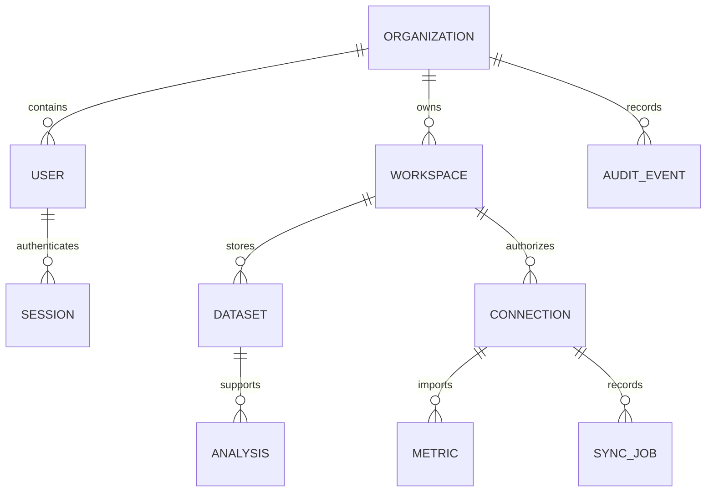

# EK-Logic architecture and delivery plan

A modular monolith: Next.js → same-origin API proxy → FastAPI → SQLAlchemy → Neon PostgreSQL. Upload bytes use local persistent storage in development or private S3-compatible object storage in production. The database stores metadata and profiles, not file bodies. No third-party business data is seeded.

## Initial vertical slice
1. Register and create an organization and first workspace in one transaction.
2. Authenticate with expiring, opaque, hashed server-side sessions in HTTP-only cookies.
3. Create and switch workspaces within the authenticated organization.
4. Upload CSV or XLSX, select a worksheet, validate bounded file contents and profile columns.
5. Confirm column meanings, choose dimensions/measures, visualize aggregated data.
6. Save analysis definitions; export the actual analysis as CSV, XLSX or PDF.
7. Connect authorized Google accounts, select verified GA4/GSC properties, synchronize daily data, inspect metric definitions and freshness.

Authorization is enforced on every object lookup using organization ownership. Phase 1 grants all organization members access to its workspaces; separate workspace ACLs and invitations are later work. Session-changing requests require a trusted Origin when supplied and a custom header. Cookies use SameSite=Lax and Secure in production. Passwords use PBKDF2-HMAC-SHA256 with individual salts. Google refresh tokens are encrypted at rest.

## Data relationships

The first migration creates these tables with foreign keys, indexes, source/date uniqueness, and non-null organization keys. Application authorization provides tenant isolation; database RLS is deferred and must be added before shared-database enterprise rollout. Files have unguessable keys and are fetched only after authorization.

## Incremental roadmap
- This milestone: registration, workspaces, data upload/profiling, saved dashboards, exports, real Google OAuth/connectors, deployment scaffolding and isolation tests.
- Operational hardening: email verification/reset, invitations, shared rate limiter, database RLS, malware scanner, retention jobs, worker queue and scheduled Google backfills.
- Marketing expansion: Windsor.ai, GBP, source deduplication, lead mappings, keyword clustering and scheduled reports.
- AI/ML: authorized query planner, read-only query role, baseline forecasts with evaluation and intervals. No pretend AI answers or predictions in the MVP.

## Metric semantics
GSC clicks and impressions are summed; CTR = clicks/impressions; average position is impression-weighted. GSC daily unfiltered totals are separate from query-level coverage and are not live rankings. GA4 sessions and event counts are additive; active users, engagement rate and event-to-lead attribution are not implemented in this slice. GA4 key events are not labeled leads. Only one active Google connection per provider/workspace is permitted to prevent overlapping imports.

Google synchronization is manually triggered and bounded to 31 days per request. It is not a background scheduler. Daily provider requests are idempotently upserted. Historic jobs record status/count/error without token contents. Failed jobs roll back imported days; reruns are safe. Synchronize requests sequentially for each source.
